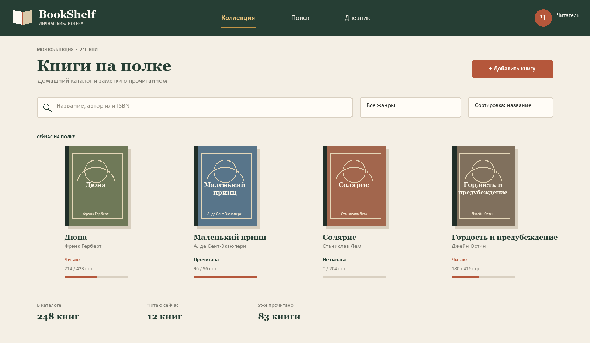
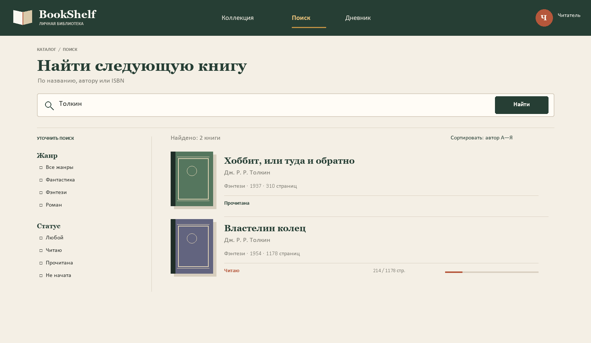
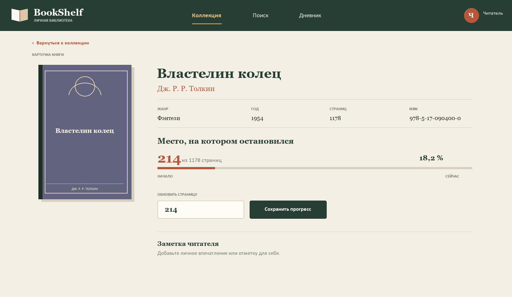
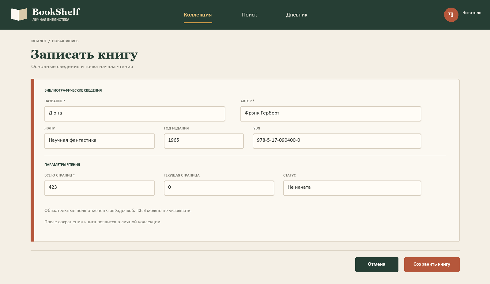
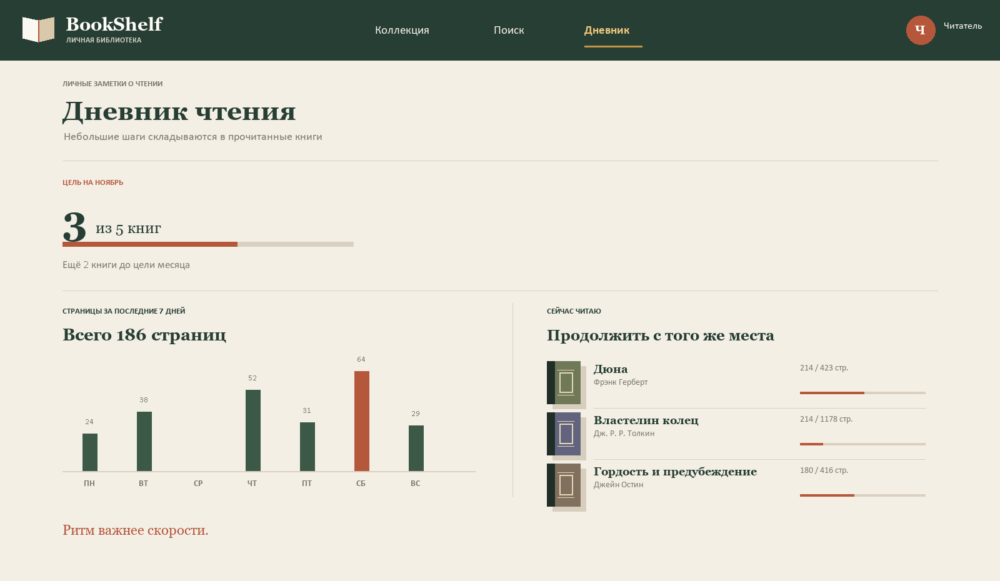

# Спецификация требований к ПО

## BookShelf — система управления личной библиотекой

**Версия:** 0.2 · **Статус:** черновик · **Дата:** 2026-11-02
**Тип приложения:** настольное приложение для Windows

## Оглавление

1. [Введение](#1-введение)
2. [Обзор продукта](#2-обзор-продукта)
3. [Требования](#3-требования)
4. [Верификация](#4-верификация)
5. [Приложения](#5-приложения)

## История изменений

| Версия | Дата | Изменение |
|---|---|---|
| 0.1 | 2026-11-02 | Первичный проект требований |
| 0.2 | 2026-11-02 | Учебный сценарий рецензирования: приняты три замечания, одно отложено |

## 1. Введение

### 1.1 Назначение документа

Документ фиксирует требования к BookShelf — приложению для ведения личного каталога книг, поиска и сортировки записей, а также учёта прогресса чтения. Он предназначен для владельца библиотеки, разработчика и проверяющего.

### 1.2 Область применения

BookShelf позволяет читателю хранить библиографические сведения о книгах, находить нужные записи и запоминать страницу, на которой чтение было остановлено. Первая версия рассчитана на одного пользователя и локальную библиотеку.

В объём версии 1.0 входят:

- добавление, просмотр, редактирование и удаление записей книг;
- поиск по названию, автору и ISBN;
- фильтрация по жанру и статусу чтения;
- сортировка по названию, автору, году издания и прогрессу;
- изменение текущей страницы, расчёт доли прочитанного и статуса;
- локальное хранение каталога между запусками приложения.

В версию 1.0 не входят синхронизация между устройствами, чтение электронных файлов, рекомендации, социальные функции, покупка и выдача книг, мобильное приложение и интеграция с внешними каталогами.

### 1.3 Термины и сокращения

| Термин | Определение |
|---|---|
| Каталог | Список книг, внесённых пользователем в BookShelf |
| Прогресс чтения | Текущая страница и рассчитанная по ней доля прочитанного |
| ISBN | Международный стандартный номер книги |
| Must / Should / Could | Приоритет требования по MoSCoW: обязательно / желательно / возможно |
| SRS | Спецификация требований к программному обеспечению |

### 1.4 Ссылки

1. Лабораторная работа № 3 «Разработка и документирование бизнес-требований», предоставленный методический PDF.
2. Шаблон кафедры: srs-template.md.
3. Модель требований: sysml/bookshelf.sysml.

### 1.5 Обзор документа

Раздел 2 описывает продукт и его ограничения. Раздел 3 содержит внешние интерфейсы и проверяемые требования. Раздел 4 связывает требования с методами проверки. В разделе 5 перечислены графические материалы.

## 2. Обзор продукта

### 2.1 Перспектива продукта

BookShelf — самостоятельное настольное приложение. В версии 1.0 приложение не требует учётной записи и доступа к сети. Сведения пользователя сохраняются локально.

### 2.2 Функции продукта

Основные функции:

1. вести каталог личных книг;
2. искать, фильтровать и сортировать записи;
3. показывать карточку книги;
4. сохранять текущую страницу чтения;
5. рассчитывать процент прочитанного и статус книги;
6. показывать сводку по состоянию каталога.

### 2.3 Ограничения продукта

- целевая операционная система — Windows 10 или Windows 11;
- пользователь работает с приложением на одном устройстве;
- каталог хранится локально;
- запись книги должна иметь название, автора и положительное количество страниц;
- текущая страница должна быть целым числом от 0 до общего количества страниц.

### 2.4 Характеристики пользователей

Основной пользователь — владелец личной библиотеки. Он самостоятельно добавляет книги, указывает их сведения, находит записи и обновляет прогресс чтения. Административная роль и управление общим каталогом не предусмотрены.

### 2.5 Допущения и зависимости

- пользователь вводит библиографические сведения самостоятельно;
- общее количество страниц известно пользователю и указано для конкретного издания;
- формат отображения и расчёта прогресса использует целое число страниц;
- локальная база данных доступна приложению на устройстве пользователя.

### 2.6 Распределение требований

Обязательные функции каталога, поиска и прогресса входят в первую итерацию. Расширенные фильтры и сортировки, последнее место чтения и дополнительная сводка планируются последующими итерациями. Идентификаторы и приоритеты приведены в таблицах раздела 3.

## 3. Требования

### 3.1 Внешние интерфейсы

#### 3.1.1 Пользовательский интерфейс

Интерфейс предоставляет каталог, строку поиска, фильтры, выбор сортировки, карточку книги, форму добавления и экран дневника чтения. Мокапы показывают предполагаемую компоновку; они являются прототипами, а не описанием уже реализованной программы.

#### 3.1.2 Аппаратные интерфейсы

Специальные аппаратные интерфейсы не требуются. Ввод выполняется клавиатурой и указателем через стандартные средства Windows.

#### 3.1.3 Программные интерфейсы

В проекте выбраны C# и .NET 10, WPF для настольного интерфейса и SQLite для локальных данных. Внешние веб-сервисы в версии 1.0 не используются.

### 3.2 Функциональные требования

| ID | Требование | Приоритет | Критерий приёмки / проверка |
|---|---|---|---|
| REQ-FUNC-001 | Система должна добавлять книгу с названием, автором и количеством страниц. | Must | Запись с заполненными обязательными полями появляется в каталоге. |
| REQ-FUNC-002 | Система должна позволять изменить сохранённые сведения о книге. | Must | После сохранения в каталоге и карточке показаны новые значения. |
| REQ-FUNC-003 | Система должна удалять книгу только после подтверждения пользователя. | Should | Отмена подтверждения сохраняет запись; подтверждение удаляет её из каталога. |
| REQ-FUNC-004 | Система должна показывать каталог книг пользователя. | Must | Каждая запись отображает название, автора и статус чтения. |
| REQ-FUNC-005 | Система должна открывать карточку выбранной книги. | Must | Карточка показывает библиографические сведения и текущий прогресс. |
| REQ-FUNC-006 | Система должна искать книги по названию или автору. | Must | Результаты содержат только записи, соответствующие запросу. |
| REQ-FUNC-007 | Система должна искать книгу по ISBN, если ISBN внесён. | Could | Поиск возвращает запись с совпадающим ISBN. |
| REQ-FUNC-008 | Система должна фильтровать каталог по жанру. | Should | После выбора жанра отображаются только книги выбранного жанра. |
| REQ-FUNC-009 | Система должна фильтровать каталог по статусу чтения. | Should | Для каждого из трёх статусов отображаются соответствующие записи. |
| REQ-FUNC-010 | Система должна сортировать каталог по названию. | Must | Названия отображаются в выбранном алфавитном направлении. |
| REQ-FUNC-011 | Система должна сортировать каталог по автору. | Should | Авторы отображаются в выбранном алфавитном направлении. |
| REQ-FUNC-012 | Система должна сортировать каталог по году издания. | Should | Книги упорядочиваются по году; записи без года размещаются отдельно в конце. |
| REQ-FUNC-013 | Система должна сортировать каталог по проценту прочитанного. | Could | Порядок соответствует рассчитанным значениям прогресса. |
| REQ-FUNC-014 | Система должна сохранять текущую страницу книги. | Must | После сохранения в карточке отображается указанная страница. |
| REQ-FUNC-015 | Система должна рассчитывать процент чтения как текущая страница / всего страниц × 100. | Must | Результат округляется до одного знака после запятой и находится в диапазоне 0–100 %. |
| REQ-FUNC-016 | Система должна присваивать книге статус «Не начата», «Читаю» или «Прочитана». | Must | 0 страниц — «Не начата»; от 1 до totalPages − 1 — «Читаю»; totalPages — «Прочитана». |
| REQ-FUNC-017 | Система должна помечать книгу прочитанной, когда текущая страница равна общему количеству страниц. | Must | При currentPage = totalPages отображаются 100 % и статус «Прочитана». |
| REQ-FUNC-018 | Система должна отклонять недопустимое количество страниц или прогресс вне диапазона. | Must | Значения totalPages ≤ 0, currentPage < 0 и currentPage > totalPages не сохраняются. |
| REQ-FUNC-019 | Система должна сохранять каталог локально между запусками. | Must | После закрытия и повторного запуска сохранённые записи доступны. |
| REQ-FUNC-020 | Система должна предупреждать о повторном ISBN. | Could | До сохранения показывается предупреждение и пользователь может отменить действие. |
| REQ-FUNC-021 | Система должна сохранять последнюю позицию чтения для каждой книги. | Should | После повторного открытия карточки показана последняя сохранённая страница. |
| REQ-FUNC-022 | Система должна показывать количество книг по статусам чтения. | Could | Сводные количества совпадают с количеством записей каждого статуса. |

### 3.3 Качество обслуживания

| ID | Атрибут | Целевое значение | Проверка |
|---|---|---|---|
| REQ-PERF-001 | Поиск, 95 % операций, каталог до 5000 записей | Не более 2 с | Измерение времени выполнения поиска |
| REQ-PERF-002 | Сортировка каталога до 5000 записей | Не более 1 с | Измерение времени сортировки |
| REQ-PERF-003 | Открытие карточки книги | Не более 1 с | Измерение времени открытия |
| REQ-REL-001 | Сохранение подтверждённого изменения | Не более 1 с | Наблюдение за сохранением |
| REQ-REL-002 | Сохранность подтверждённых локальных изменений | Данные доступны после перезапуска | Перезапуск и сравнение записей |
| REQ-USE-001 | Переход от каталога к обновлению прогресса | Не более 3 действий | Демонстрация сценария |
| REQ-USE-002 | Работа с основными действиями клавиатурой | Tab, Enter и Esc доступны | Инспекция интерфейса |
| REQ-COMP-001 | Поддерживаемые ОС | Windows 10 и Windows 11 | Запуск на каждой поддерживаемой ОС |
| REQ-COMP-002 | Минимальный размер окна | 1280 × 720 пикселей | Инспекция компоновки |
| REQ-MAINT-001 | Покрытие тестами логики каталога и прогресса | Не менее 80 % | Отчёт инструмента покрытия |

### 3.4 Соответствие стандартам

Для программной реализации специальных отраслевых сертификатов не требуется. Требования к формулировкам и структуре документа основаны на шаблоне SRS кафедры и задании лабораторной работы.

### 3.5 Проектирование и реализация

#### 3.5.1 Установка и платформа

Приложение предназначено для Windows 10 и Windows 11. Установка и поставка определяются на этапе реализации.

#### 3.5.2 Сборка и сопровождение

Выбранный стек проекта — C#/.NET 10, WPF и SQLite. Конкретная схема сборки и поставки будет уточнена при проектировании.

#### 3.5.3 Стоимость и сроки

Оценка стоимости и календарный план не входят в требования к поведению первой версии и должны быть согласованы отдельно.

### 3.6 ИИ/МО

Функции искусственного интеллекта и машинного обучения не входят в версию 1.0.

## 4. Верификация

На текущем этапе приложение не реализовано. Все методы ниже являются планом проверки, а не результатами выполненных испытаний.

| Группа / ID | Метод | Проверяемый артефакт |
|---|---|---|
| REQ-FUNC-001…005 | Демонстрация и инспекция | Формы каталога и карточки книги |
| REQ-FUNC-006…013 | Тестирование | Поиск, фильтры и сортировки на тестовом каталоге |
| REQ-FUNC-014…018 | Тестирование и анализ | Контрольные значения прогресса и границ страницы |
| REQ-FUNC-019…022 | Тестирование и демонстрация | Перезапуск приложения, предупреждение о ISBN, сводка |
| REQ-PERF-001…003 | Измерение | Время операций на каталоге до 5000 записей |
| REQ-REL-001…002 | Тестирование | Сохранение и повторное открытие локальных данных |
| REQ-USE-001…002 | Демонстрация и инспекция | Навигация мышью и клавиатурой |
| REQ-COMP-001…002 | Испытание и инспекция | Запуск и отображение окна на поддерживаемых ОС |
| REQ-MAINT-001 | Анализ | Отчёт покрытия автоматизированными тестами |

## 5. Приложения

### 5.1 Мокапы интерфейса

### 5.2 Диаграммы и модель

- [Диаграмма вариантов использования](img/sysml-usecases.png)
- [Иерархия функциональных требований](img/sysml-functional.png)
- [Иерархия качественных требований](img/sysml-quality.png)
- [Модель предметной области](img/sysml-domain.png)
- Текстовая модель требований: sysml/bookshelf.sysml.
- Исходники диаграмм Graphviz: sysml/dots/.

### 5.3 Учебное рецензирование

Примеры замечаний заказчика в отчёте обозначены как смоделированный учебный сценарий. Они не являются подтверждением фактически созданного pull request или состоявшегося интервью.
