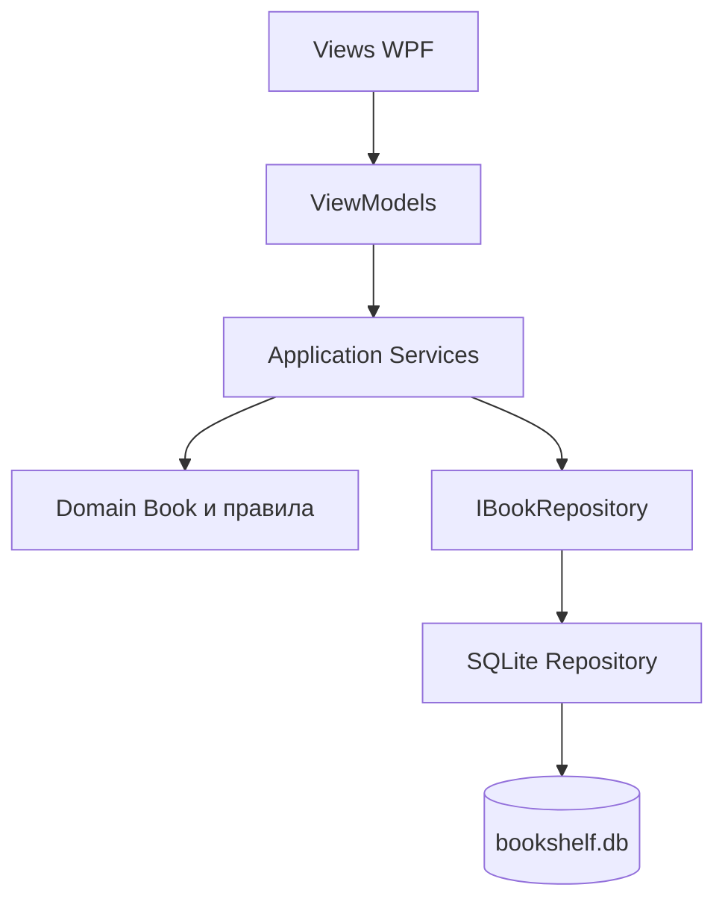

# Описание дизайна программного обеспечения
Для BookShelf — системы управления личной библиотекой

Версия 0.2. Подготовил М. А. Самойлов, группа 450503, БГУИР. Дата: 09.11.2026.

## Оглавление
1. Введение
2. Обзор дизайна
3. Проектные представления
4. Решения
5. Приложения

## История изменений
| Версия | Основание |
| --- | --- |
| 0.1 | Первичная архитектура и план |
| 0.2 | CR-001: перенос сводки по статусам |

## 1. Введение
### 1.1 Назначение документа
SDD задаёт структуру будущей реализации требований BookShelf и контракты компонентов. Разработчик использует его при написании кода, заказчик — при проверке границ выпуска, проверяющий — для сопоставления требований и испытаний.
### 1.2 Область применения
Локальное настольное приложение на C#, .NET 10 и WPF; хранение SQLite. Каталог поддерживает управление книгами, поиск, фильтрацию, сортировку и прогресс. Облачная синхронизация, социальные функции и покупка книг исключены из версии 1.0. Резервное копирование не входит в текущий объём.
### 1.3 Определения, акронимы и сокращения
ADR — запись принятого проектного решения; CR — запрос на изменение; MVVM — разделение представления, его модели и предметной модели; SDD — описание проектирования; SRS — спецификация требований; MVP — минимальный согласованный выпуск.
### 1.4 Ссылки
Нормативные входы: отчёт ЛР3 BookShelf, SRS 0.2; приложенные методические указания ЛР4; sdd-template.md и adr-template.md. Связанные файлы: ../docs/lab4/system-requirements.md, ../docs/lab4/requirements-priority.md, ../adr/0001-local-mvvm-sqlite.md. Новые версии дополняют SRS; исходная спецификация не перезаписывается.
### 1.5 Обзор документа
Раздел 2 поясняет выбор проектных точек зрения. Раздел 3 определяет компоненты, данные и сценарии. Раздел 4 связывает архитектуру с ADR. Раздел 5 содержит ссылки на планы и проверки. Изменение требования сопровождается новой записью в истории и журнале CR.

## 2. Обзор дизайна
### 2.1 Задачи стейкхолдеров
Владелец коллекции ожидает сохранения книг и места чтения без подключения к сети. Заказчику нужны известная стоимость, демонстрации по итерациям и предел изменения бюджета. Исполнитель отвечает за проверяемость правил и изоляцию компонентов.
### 2.2 Выбранные точки зрения
Используются Context, Composition, Logical, Dependency, Information, Interface, Interaction, Algorithm, State dynamics, Concurrency, Patterns, Deployment и Resources. Physical и Structure не выделяются в самостоятельные модели: сведения об одном рабочем месте и внутренней структуре покрываются Deployment и Composition. Все точки зрения исходного шаблона рассмотрены.

## 3. Проектные представления
### BS-01 Контекст
Viewpoint: Context. Читатель взаимодействует с WPF-приложением и локальным файлом базы. Сетевые участники отсутствуют. REQ-FUNC-001–022, REQ-COMP-001. Решение ADR-0001.
### BS-02 Состав компонентов
Viewpoint: Composition, Patterns. Views содержат XAML и привязки; ViewModels предоставляют команды и состояние; Application Services выполняют сценарии; Domain хранит правила книги; Infrastructure реализует SQLite. UI не выполняет SQL и не вычисляет статус. CatalogService управляет CRUD, SearchService — запросами, ProgressService — страницей. Резервное копирование не входит в текущий объём.

### BS-03 Предметные классы
Viewpoint: Logical. Book содержит Id, Title, Author, Genre, PublicationYear, Isbn, TotalPages, CurrentPage, UpdatedAt. ReadingStatus вычисляется из двух полей страницы. Поиск принимает CatalogQuery с текстом, жанром, статусом, полем и направлением сортировки. Связь: REQ-FUNC-001–018, 020–021.
### BS-04 Зависимости
Viewpoint: Dependency. F02 опирается на F01; F03 требует F02; F04 требует базовый CRUD; F05 и F06 используют каталог; F07 требует Book и репозиторий; F08 требует нормализацию ISBN в F03/F05; F10 следует за всей функциональностью выпуска. В финальном плане F11 требует готового контракта F02 и завершается до F10. При разбиении функции её первая часть создаёт проверяемый сценарий; оставшиеся критерии не считаются завершёнными.
### BS-05 Информация
Viewpoint: Information. Таблица Books: Id INTEGER PRIMARY KEY; Title TEXT NOT NULL; Author TEXT NOT NULL; Genre TEXT NULL; PublicationYear INTEGER NULL; Isbn TEXT NULL; TotalPages INTEGER NOT NULL CHECK(TotalPages>0); CurrentPage INTEGER NOT NULL DEFAULT 0 CHECK(CurrentPage>=0 AND CurrentPage<=TotalPages); UpdatedAt TEXT NOT NULL. Таблица SchemaInfo хранит версию формата. Индексы — по Title, Author и Isbn; нормализованные значения ISBN используются при сравнении. Title/Author проверяются после Trim. Isbn не имеет UNIQUE-ограничения: по SRS нужен диалог предупреждения. Статус и процент не дублируются в базе. Все изменения книги выполняются атомарно.
### BS-06 Контракты
Viewpoint: Interface. IBookRepository: Add(Book), Update(Book), Delete(id), Get(id), Query(CatalogQuery). ProgressService.SetPage(id,page) проверяет диапазон, сохраняет в транзакции и возвращает новый статус. Результат операции содержит Success, ValidationError или StorageError. В финальной версии BackupService.Create(path) и Restore(path) используют согласованный снимок хранилища; неизвестная версия возвращает UnsupportedVersion. UI показывает понятную причину отказа, не раскрывая SQL.
### BS-07 Сохранение страницы
Viewpoint: Interaction. Пользователь задаёт страницу → ViewModel вызывает ProgressService → сервис проверяет границы → Repository фиксирует запись → ViewModel обновляет карточку и каталог. При ошибке фиксации прежнее отображаемое значение сохраняется, форма остаётся открытой. Проверка: REQ-FUNC-014–019, 021; REQ-REL-001–002.
### BS-08 Алгоритм и состояния
Viewpoint: Algorithm, State dynamics. Допустимо только целое p при 0 ≤ p ≤ n и n > 0. Процент r = 100p/n, отображение с одним десятичным знаком. p=0 → «Не начата»; 0<p<n → «Читаю»; p=n → «Прочитана». Уменьшение страницы допустимо и пересчитывает статус. При уменьшении TotalPages ниже CurrentPage изменение отклоняется; скрытое обнуление позиции запрещено. Примеры: 0/320 → 0 %; 80/320 → 25 %; 320/320 → 100 %; 321/320 → отказ.
### BS-09 Параллелизм
Viewpoint: Concurrency. Длительные операции выполняются вне UI-потока; результат применяется через диспетчер WPF. Записи сериализуются, один экземпляр приложения владеет базой. Восстановление блокирует команды записи до завершения замены. SQL-запросы параметризуются. Для поиска по русским названиям применяется согласованная нормализация регистра в .NET; поддержка кириллицы не основывается на встроенном NOCASE SQLite.
### BS-10 Развёртывание
Viewpoint: Deployment. Один ПК Windows, установленный настольный пакет; база размещается в каталоге данных пользователя, отдельно от исполняемых файлов. Секреты и сетевые учётные записи не требуются. Проверяются Windows 10/11 и окно от 1280×720. Точная совместимость выбранной версии runtime проверяется при упаковке; исходная целевая платформа ЛР3 сохраняется как требование.
### BS-11 Ресурсы и качество
Viewpoint: Resources. Контрольный каталог содержит 5000 книг; поиск ≤2 с для 95 % запросов, сортировка и карточка ≤1 с. Измерения описаны в system-requirements.md. Итерация — 10 рабочих дней, общий срок — 6 итераций. Бюджет учитывает только оценённые человеко-дни; календарный резерв не оплачивается как отдельная выполненная работа. Проверки включены в оценки F01–F09/F11; F10 отвечает за общую регрессию, измерения, упаковку и инструкцию.

## 4. Решения
ADR-0001 — локальное приложение WPF/MVVM/SQLite; ADR-0002 — организация F11 и подключение junior (только в версии 0.3). CR-001 отражает перенос сводки, CR-002 — расширение функциональности. Статус документа до реального отзыва заказчика: проект для согласования.

## 5. Приложения
Матрица требований и методов проверки: ../docs/lab4/system-requirements.md. Оценки и приоритеты: ../docs/lab4/requirements-priority.md. Планы: ../docs/lab4/plan-v01.md и последующие доступные версии. Сценарий обсуждения: ../docs/lab4/customer-discussion-script.md.
